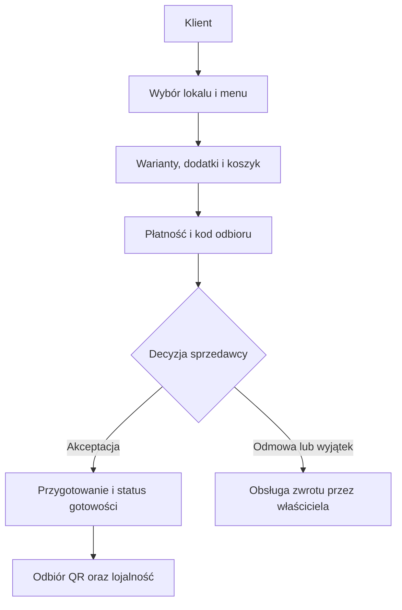
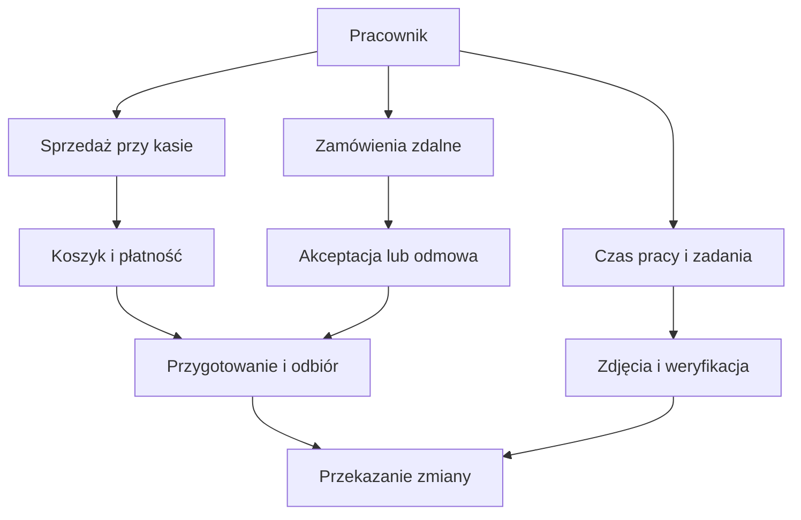
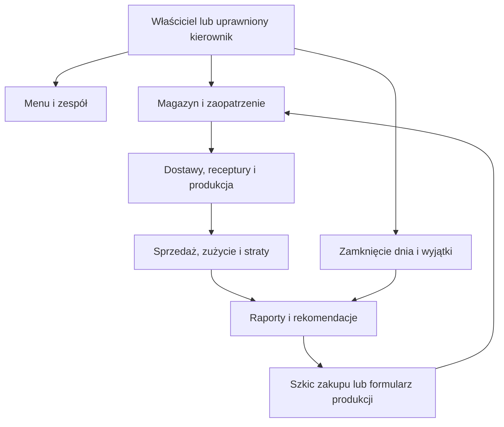

# Nimble — stan, pozostała praca i ścieżki użytkownika

Audyt 18.10.2026. Baza kodu c3e61e3335fa445ddc3a1dbf0c5ea1cffab1f855.
To przegląd implementacji, powiązań ekranów/API, planu i dowodów testowych;
nie nowy pełny audyt każdej linii ani odbiór działającej instancji produkcyjnej.

## Wniosek

Większość funkcji biznesowych ma implementację. Nie można jeszcze potwierdzić,
że cały produkt działa poprawnie razem na telefonie. Pozostają testy integracji,
natywnej współbieżności, awarii, odtworzenia danych i prawdziwych płatności.
Nie utożsamiamy obecności kodu, zaliczonych testów i gotowości produkcyjnej.

## Możliwości obecne w kodzie

| Temat | Co można zrobić w zaimplementowanym przepływie | Granica potwierdzenia |
|---|---|---|
| Sprzedaż przy kasie | Koszyk, warianty, dodatki, zestawy, rabaty, płatność, QR odbioru | Fizyczny telefon i rzeczywiste płatności do odbioru |
| Zamówienia zdalne | Wybór lokalu i menu, zamówienie, płatność, akceptacja/odmowa sprzedawcy, przygotowanie i odbiór | Odmowa tworzy zobowiązanie do zwrotu, nie dowód wykonanego zwrotu |
| Gotowość i lojalność | Gotowe pozycje, gotowe zamówienie, worker powiadomienia, karta i nagrody | Sygnał w tle/zablokowany ekran oraz trwałość workera na natywnej bazie otwarte |
| Menu | Szkic/publikacja, harmonogram, zdjęcia, alergeny, języki, konfiguracja zestawów | Pełny przegląd mobilny i kompletność polskich komunikatów do wykonania |
| Uprawnienia | Właściciel, kierownik z delegacją, kasjer; ochrona operacji portfela | Końcowy test odebrania praw i niezależnych sesji otwarty |
| Zespół | Grafik, zastępstwa, ewidencja pracy i przerw, zadania, zdjęcia, weryfikacja/poprawa | Pełny dzień i fizyczna kamera do odbioru |
| Magazyn | Dostawy, spisy, korekty, straty, rezerwacje, receptury, produkcja, partie i terminy | Równoległe operacje na natywnym PostgreSQL do potwierdzenia |
| Zaopatrzenie | Szkice zakupów, zamówienia dostaw, przyjęcie, rekomendacje z historii | Nie wysyła automatycznie maila ani zamówienia do dostawcy |
| Propozycje produkcji | Historia, wzór, składniki i limity, kopiowanie do formularza | Brak osobnego trwałego szkicu; faktyczny uzysk wpisuje operator |
| Koniec dnia | Rozliczenie żywności/utylizacji, przekazanie zmiany, zamknięcie dnia i wyjątki | Brak aktualnego pełnego E2E obejmującego wszystkie moduły |
| Finanse | Wyjątki wpłat, zwroty, raporty/eksport, historyczne koszty i marża składnikowa | Marża nie jest zyskiem netto; nieznane koszty pozostają nieznane |
| Kopie | Pełny kod z historią Git; poprawiony backup bazy i zdjęć | Odtworzenie kodu sprawdzone; odtworzenie działającego lokalu jeszcze nie |

Sprawdzono obecność tras apps/api/src/routes oraz wpięcie paneli w
apps/web/src/merchant/Merchant.tsx i InventoryBoard.tsx, a także raporty
docs/product i kryteria PL-22. W e2e istnieją happy-path, edge-cases,
remote-demo i pre-live-modules. Ich obecność nie dowodzi zaliczenia R06;
remote-demo jest demonstracją, a pre-live-modules obejmuje tylko część modułów.

## Wyniki i wykryte braki

- Ostatnia pełna regresja: API 373/374, 73 pliki bez pominięć i duplikatów;
  web 288/288; shared 57/57; typy i build zaliczone.
- Wyniki dotyczą kodu 01ff6db. Do c3e61e3 zmieniły się tylko dwa dokumenty;
  w tym audycie również nie zmieniamy kodu aplikacji. Nie uruchomiono ponownie
  pełnej regresji i nie przedstawiamy jej jako nowego przebiegu.
- Jedyny niezaliczony test API to merchantNotificationPersistence:
  wymaga natywnego PostgreSQL. PGlite nie sprawdza niezależnych połączeń.
- W tym audycie ponowiono backup/runner: 9/9. git fsck --full zakończył się
  poprawnie; pojedynczy dangling blob nie oznacza uszkodzenia osiągalnej historii.
- Brak nowego pełnego E2E całego dnia po dodaniu ekonomii i rekomendacji.
- Trwały osobny szkic produkcji nie jest zaimplementowany. PL-22 wymaga
  edytowalnego szkicu; należy domknąć trwałość lub jawnie zatwierdzić węższy
  kontrakt. Nie zamykamy tej pozycji samym kopiowaniem pól formularza.
- W ekranach są jeszcze angielskie teksty; obecność konkretnych komunikatów
  w Merchant.tsx potwierdza potrzebę przeglądu językowego w R07.
- Nie ma potwierdzonego aktualnego wdrożenia pełnej wersji pod HTTPS.
- Dawne statusy w trackerze i planach są historyczne. Bieżący stan należy
  czytać z niniejszego raportu i recovery-implementation-running.md.

## Ile zostało i w jakiej kolejności

W planie naprawczo-końcowym jest 9 etapów. R01 i R02 mają wykonany zakres
implementacyjny i kopie. Pozostaje 7 etapów otwartych, lecz R03–R05 mają już
znaczną część kodu. To liczba etapów, nie 7/9 nakładu pracy i nie procent produktu.
Nie ma podstaw do wiarygodnego procentu ani terminu bez domknięcia integracji.

| Kolejność | Etap | Pozostały rezultat |
|---|---|---|
| 1 | R03 | Natywny PostgreSQL 16, pełne API, niezależne sesje i trwałość powiadomień na konkretnej wersji |
| 2 | R04 | Odbiór kosztów i marży na natywnej bazie; funkcje i testy pomocnicze już są |
| 3 | R05 | Trwały edytowalny szkic produkcji, odświeżenie/wznowienie i brak duplikacji; wspólny odbiór rekomendacji |
| 4 | R06 | Pełny dzień lokalu, dwa lokale i role, restart, timeout, ponowienia, zwroty |
| 5 | R07 | Telefon 320/390/736/1280 px, błędy/puste stany, polskie komunikaty, pomiar wydajności |
| 6 | R08 | Instalacja/migracja i odtworzenie bazy wraz ze zdjęciami do pustej instancji; kontrola prywatności |
| 7 | R09 | Jedna sprawdzona wersja, macierz MM-01–30, testowe HTTPS, pakiet odbioru i rzeczywisty Android/Nimiq Pay |

Po nich pozostaje decyzja o uruchomieniu publicznym na podstawie odbioru.
Nie przenosimy na właściciela przechowywania kodu ani wykonywania pushów.
AI-01 zapisano osobno jako WKRÓTCE w docs/product/soon-ai-assistant.md;
nie rozpoczęto implementacji i nie doliczamy jej do starego zakresu.

## Ścieżki użytkownika

Diagramy przedstawiają implementowane możliwości, nie potwierdzenie odbioru
produkcyjnego. Płatności, portfel i powiadomienia wymagają testów rzeczywistych.

Wypłaty z portfela pozostają właścicielskie. Kierownik otrzymuje tylko
konkretne delegowane prawa; diagram nie nadaje mu wszystkich praw właściciela.

## Odtwarzalność

Poprzedni pełny checkpoint kodu: NIMBLE-FULL-CODE-R05-PRODUCTION-PROPOSALS.zip,
libfile_ee182dc2b5c481918fffe9d8526f3193,
SHA256 7e4f95a56aa5bcd90b9e43dfdb627e18cc224dd173bbccea1c5c7ab9976a7f69.
Ten audyt i backlog zostają zapisane w nowym pełnym checkpointcie wraz z kodem
i osiągalną historią Git. Kopia źródeł nie obejmuje produkcyjnej bazy i sekretów.
